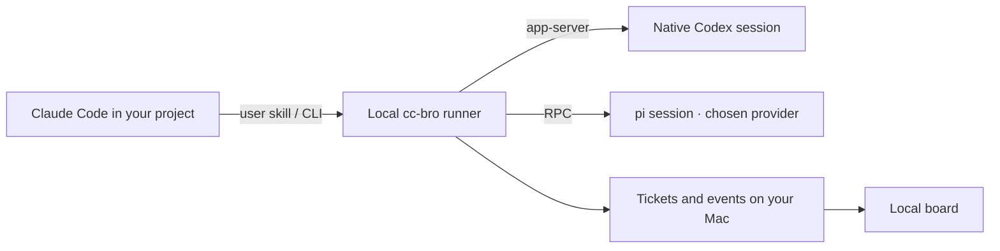

# cc-bro

[中文](README.zh-CN.md) · [Website](https://cc-bro.yanauto.me/) · [Docs](https://cc-bro.yanauto.me/docs/) · [Changelog](CHANGELOG.md)

Delegate tickets from the Claude Code chat already open in your project. Each named worker keeps its session, so you can work in parallel, add an instruction mid-turn, or come back to yesterday’s fix. Choose the worker for each ticket.

| Worker ID | Where it runs |
| --- | --- |
| `codex` | Your native Codex CLI, using app-server and its existing login. |
| `pi:<provider>` | Your pi CLI, using that provider’s models and login. For example, `pi:openai-codex` uses your Codex subscription through pi, and `pi:deepseek` uses your configured DeepSeek account. |

Claude Code manages the project. If you want Claude itself to investigate or review something, ask the manager to use a native Claude Code subagent.

## Start in your project

On macOS, install Node.js 24+, Claude Code, and the worker CLI or CLIs you choose. Sign in using each worker’s own CLI. Tested with Codex CLI 0.162.1 and pi 1.5.0.

```sh
npm install -g cc-bro@0.2.0
cc-bro setup
cc-bro init
cc-bro ui
```

Run `init` in the project root. A terminal prompts for the allowed worker IDs and the project default. For a script, pass the choices explicitly. One allowed ID is also the default. With several allowed IDs, choose one. Rerunning plain `init` preserves your existing policy.

```sh
cc-bro init --allow codex,pi:openai-codex,pi:deepseek --default-worker pi:deepseek
```

In your current Claude Code chat, type **/cc-bro** and describe the job. For example, “Have one worker fix the token expiry bug in a separate worktree. Ask a different worker to review the patch.” Reopen Claude Code in the project if the newly installed skill is not visible.

## Dispatch, steer and review

| Command | Result |
| --- | --- |
| `cc-bro say auth-fix "Fix token expiry." --worktree --bg --json` | The project default gets a fresh Git worktree at committed HEAD. The receipt gives the name and turn. |
| `cc-bro say coverage "Locate auth tests." --worker codex --bg` | A second name runs in parallel. Three turns can run across projects by default. |
| `cc-bro say check "Inspect the failing test." --worker pi:openai-codex --bg` | pi picks a model within the permitted provider. To pin one, pass an exact `--model provider/model-id` from `pi --list-models`. The session stays bound to the selected model. |
| `cc-bro say auth-fix "Cover expired refresh tokens too." --bg --json` | The receipt reports injection into the active turn, queueing for the next turn, or rejection with a reason. Both backends support steering. |
| `cc-bro wait auth-fix 1` | Wait for the turn in the receipt. If the follow-up was queued for turn 2, wait for 2 before asking for review. |
| `cc-bro review auth-fix --by codex` | With the pi writer in this example, Codex reviews the completed turn in a linked ticket. For a Codex writer, use e.g. `--by pi:deepseek`. |
| `cc-bro show auth-fix --json` · `cc-bro done auth-fix` | Inspect the result and accept the writer. Accept the review separately using the name in its receipt. |

Each review needs a different allowed worker ID. Native `codex` and `pi:openai-codex` are distinct. Two pi workers with the same provider ID are the same choice, even with different models. The reviewer gets the completed turn’s instructions, reply and file summary. Keep the checkout stable until the review finishes.

Choose `--worktree` on the first message when a code ticket needs an independent diff. Ordinary workers use the registered directory, including its uncommitted changes. On acceptance, the manager gets the worktree path and decides what to merge and when to clean up.

## Where work runs



The board shows **Queued → Working → Review → Done**, with steps, branches, changed files, review links, follow-up receipts and the last reported input cache hit rate. Results go to SQLite before the manager receives its background notification. Use `ls`, `show` or `wait` to reconnect, and `stop NAME` to cancel.

The registry and ticket history live in `~/.cc-bro/`. The project gets a self-ignored `.cc-bro/` marker. Native Codex can fall back to `exec --json` if app-server is unavailable before submission. That transport queues follow-ups for the next turn.

**Upgrading with an old runner still active?** Use `cc-bro shutdown` from the new installation, then retry your command. Shutdown stops running and queued work in every project on that runner. Wait before shutting down if you want those turns to finish. Unfinished turns do not resume automatically; files already written stay on disk.

After installing, rerun `cc-bro setup`. Register 0.1 projects with `init` in the separate 0.2 registry; the old ticket database stays on disk. For earlier 0.2 previews, supported permissions and history carry forward. If the old default was retired, choose a new project default.

**From source**, use `npm run install:local` to build and install the tarball. Run `npm test` on macOS with Codex and Claude Code installed for the protocol and manager notification checks. The tests use local model fixtures. Set `CC_BRO_HOME` and `CC_BRO_PORT=0` for an independent instance.

[Apache-2.0 license](LICENSE)
