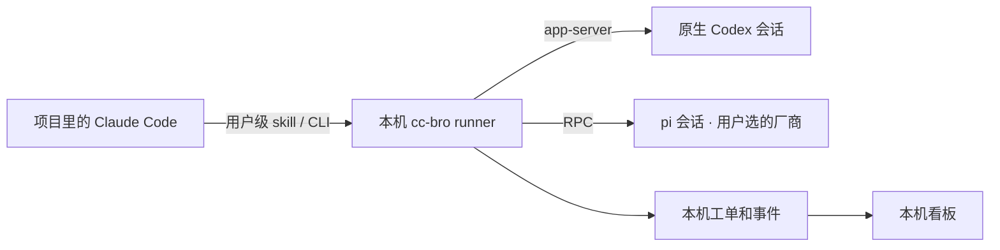

# cc-bro

[English](README.md) · [官网](https://cc-bro.yanauto.me/) · [文档](https://cc-bro.yanauto.me/zh/docs/) · [更新日志](CHANGELOG.md)

在项目里已经打开的 Claude Code 对话中派单。每个具名工人保留自己的会话，可以并行干活、中途补要求，也可以明天继续今天的修复。每张单由你选工人。

| 工人标识 | 在哪里执行 |
| --- | --- |
| `codex` | 本机原生 Codex CLI，使用 app-server 和已有登录。 |
| `pi:<厂商>` | 本机 pi CLI，使用该厂商的模型和登录。比如 `pi:openai-codex` 通过 pi 使用 Codex 订阅，`pi:deepseek` 使用你配置的 DeepSeek 账户。 |

Claude Code 是经理。需要 Claude 自己调查或审查时，让经理直接调用 Claude Code 的原生子 agent。

## 在项目里开始

macOS 需要 Node.js 24+、Claude Code 和你选用的工人 CLI。先在各自的 CLI 登录。已实测 Codex CLI 0.162.1、pi 1.5.0。

```sh
npm install -g cc-bro@0.2.0
cc-bro setup
cc-bro init
cc-bro ui
```

在项目根目录运行 `init`。终端会询问允许哪些工人、谁是默认工人。脚本可直接传入这些选择。只允许一个标识时，它就是默认工人；允许多个时由你指定。已有项目再次运行 `init` 会保留原配置。

```sh
cc-bro init --allow codex,pi:openai-codex,pi:deepseek --default-worker pi:deepseek
```

在当前 Claude Code 对话里输入 **/cc-bro**，例如“让一个工人在独立 worktree 修复令牌过期的问题，再让另一个工人审查。”若刚装的 skill 还没出现，在项目里重新打开 Claude Code。

## 派单、插话、审查

| 命令 | 结果 |
| --- | --- |
| `cc-bro say auth-fix "修复令牌过期问题。" --worktree --bg --json` | 项目默认工人从已提交的 HEAD 建独立 worktree。回执给出名字和轮次。 |
| `cc-bro say coverage "找出登录测试。" --worker codex --bg` | 另一个名字可以并行。默认所有项目合计最多同时跑三轮。 |
| `cc-bro say check "检查失败的测试。" --worker pi:openai-codex --bg` | pi 在允许的厂商内选模型。也可从 `pi --list-models` 选择完整的 `--model 厂商/模型ID`。此名字随后绑定实际模型。 |
| `cc-bro say auth-fix "也覆盖刷新令牌过期。" --bg --json` | 两种后端都支持运行中插话。回执给出已注入、排到下一轮或被拒，以及原因。 |
| `cc-bro wait auth-fix 1` | 按回执轮次等结果。若插话排到第 2 轮，等第 2 轮结束再送审。 |
| `cc-bro review auth-fix --by codex` | 此例由 pi 写、Codex 审。审查单关联已完成的写单轮次。Codex 写的单也可交给 `--by pi:deepseek`。 |
| `cc-bro show auth-fix --json` · `cc-bro done auth-fix` | 查看结果，满意后收单。审查单用自己回执中的名字单独验收。 |

审查者必须是另一个已放行的工人标识。原生 `codex` 与 `pi:openai-codex` 可以互审。同一 pi 厂商只算一个标识，换模型也一样。审查者拿到对应轮次的要求、最终回复和文件摘要。审完前先别继续改它正在看的工作目录。

需要独立 diff 时，在第一条消息加 `--worktree`。普通工单直接用登记的项目目录，能看到其中未提交的修改。收单后由经理决定怎样整合、何时回收 worktree。

## 工作在哪里进行



看板按**排队 → 干活中 → 待验收 → 完成**展示步骤、分支、改动文件、审查关系、插话回执，以及工人最近一次上报的输入缓存命中率。结果先存入 SQLite，再通知经理。可以用 `ls`、`show`、`wait` 接着查，用 `stop 工单名` 叫停任务。

登记信息和工单历史在 `~/.cc-bro/`，项目里只有自行忽略的 `.cc-bro/` 身份标记。原生 Codex 在提交前发现 app-server 不可用时，可回退到 `exec --json`，此时插话排到下一轮。

**升级后旧服务还在运行？** 用新版执行 `cc-bro shutdown`，再重试原命令。停机会停止这个服务下所有项目正在运行和排队的单；想让它们完成，就等做完再停。未完成的轮次不会自动续跑，已经写入的文件会保留。

安装后重新运行 `cc-bro setup`。0.1 项目需用 `init` 在独立的 0.2 登记库重新登记，旧工单库保留在磁盘上。早期 0.2 预览版的历史和仍受支持的权限会保留，原默认工人已撤掉的项目需要重新选默认值。

**从源码安装**用 `npm run install:local`。在装有 Codex 和 Claude Code 的 Mac 上运行 `npm test`，可检查原生协议和经理端通知，测试回复来自本机替身。设置独立的 `CC_BRO_HOME` 和 `CC_BRO_PORT=0` 可以启动隔离实例。

[Apache-2.0 许可证](LICENSE)
